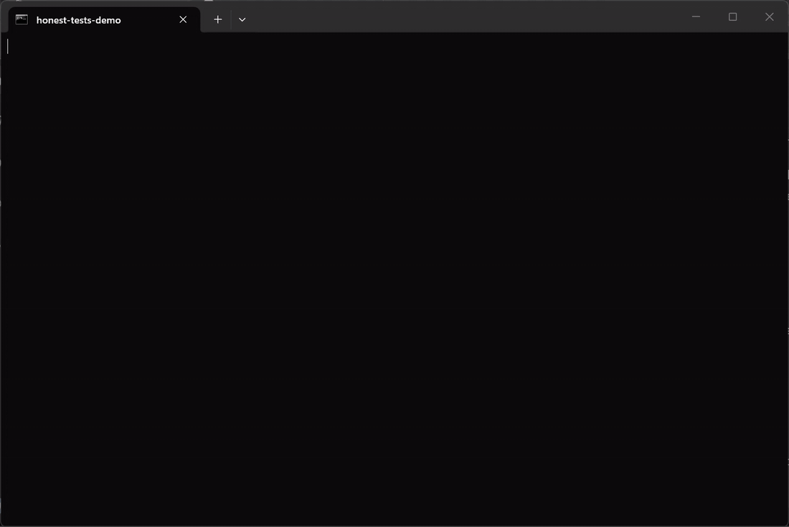

<div align="center">

# honest-tests

**Your agent's tests are lying to you.**

Agent skills that stop Claude Code, Codex, and Cursor from shipping tests that pass no matter what, and a script that **proves** it by breaking your code on purpose.



<sub>The real terminal output of <a href="examples/run_demo.py"><code>examples/run_demo.py</code></a>, recorded with ffmpeg by <a href="tools/record_demo.ps1"><code>tools/record_demo.ps1</code></a>. Nothing is edited or sped up.</sub>

</div>

## What changes

`12 tests pass` → **`31 of 38 bugs survived`** → `12 tests pass, 0 of 38 survived`. Same test count, very different safety. This is the real output of [`examples/run_demo.py`](examples/run_demo.py), no agent involved:

```text
WEAK TESTS (what the agent wrote)
  baseline: PASS, 12 tests in 0.2s
  mutants : 38

SURVIVED (31): every test still passed with this bug in place
  pricing.py:11   `>=` -> `>`                        | if qty >= 10:
  pricing.py:11   `10` -> `9`                        | if qty >= 10:
  pricing.py:25   `>=` -> `>`                        | if total >= FREE_SHIPPING_THRESHOLD:
  pricing.py:32   `-` -> `+`                         | return total - 5
  ...
12 tests pass, 31 of 38 mutants survived. Mutation score: 18% (min 80%) -> FAIL

STRENGTHENED TESTS
12 tests pass, 0 of 38 mutants survived. Mutation score: 100% (min 80%) -> PASS
```

The agent "fixed" a boundary bug (`qty > 10` → `qty >= 10`) and wrote 12 passing tests. Line 11 shows the proof they are worthless: put the original bug back and every test is still green.

| Demo | Tests | Weak suite | Strengthened suite |
|---|---|---|---|
| [Python](examples/python-demo) (`unittest`) | 12 pass | 31 of 38 mutants survive, score **18%** | 0 survive, score **100%** |
| [JavaScript](examples/js-demo) (`node:test`) | 12 pass | 35 of 44 mutants survive, score **20%** | 0 survive, score **100%** |

## The problem

Ask any coding agent to "add tests" or "fix this bug" and you will often get:

- `assert result` and `assert x is not None` as the only check
- everything mocked, so the test checks the **mock**, not the code
- `patch("pkg.the_function_under_test")`, then asserting what the patch returns
- `expect(x).toBeTruthy()` and `toBeDefined()` on values that are always defined
- snapshots written and accepted without a review
- `try: ... except Exception: pass` inside the test
- `skip`, `xfail` or a deleted test to get to green
- an assertion quietly **loosened** in the same diff that changes the code

…and then a confident *"All tests pass!"*

Existing "testing anti-pattern" skills are written guidance. They cannot tell you whether a test can fail. **honest-tests runs the check:** it applies small bugs to the lines the agent just changed and sees whether any test notices.

## The skills

| Skill | What it makes your agent do | Ships with |
|---|---|---|
| 🧬 **[mutation-check](skills/mutation-check/SKILL.md)** | After writing or changing tests, mutate only the changed lines (flipped comparisons, `and`/`or`, `+`/`-`, `true`/`false`, off-by-one constants, early return, removed calls) and kill or justify every survivor. | `mutation_check.py` |
| 🎭 **[mock-audit](skills/mock-audit/SKILL.md)** | Find tests that mock the unit under test, assert only on mocks, or mock so much no real logic runs. Prefer real dependencies or fakes. | `smell_scan.py --group mock` |
| 💪 **[assertion-strength](skills/assertion-strength/SKILL.md)** | Replace `assert result`, `toBeTruthy`, type-only checks and unreviewed snapshots with exact values; refuse `skip`/`xfail`/loosening to get green. | `smell_scan.py --diff` |
| ✅ **[done-means-verified](skills/done-means-verified/SKILL.md)** | No "fixed" without red→green proof: a test that fails on the old code, passes on the new code, the real command output, and a mutation score. | uses the two scripts |
| 🔥 **[test-roast](skills/test-roast/SKILL.md)** | A blunt, prioritised review of a test suite with a 0-10 trust score backed by the mutation score. | `smell_scan.py` |

Skills trigger on their own when the agent writes or changes tests or says "done". You can also call them by name: *"run mutation-check on this branch"*, *"roast my tests"*.

### How they fit together

```
 write test ->  assertion-strength  ->  mock-audit  ->  mutation-check  ->  done-means-verified
                (exact values?)         (real code        (can it actually      (red -> green
                                         runs?)            fail?)                proof + output)

                       test-roast: reviews a whole suite and scores it 0-10
```

Each skill ends with an **Output contract** the agent must fill with real numbers. Both scripts use only the standard library (Python 3.9+, plus `git`; Node only if you test JS). The whole pack adds about 600 tokens of always-on context; each skill loads its full text only when it triggers.

### How `mutation_check.py` works

1. `git diff --unified=0` (against `HEAD`, or `--base origin/main`, untracked files included) gives the changed source lines. Test files are ignored.
2. Mutations are applied to **those lines only**, one at a time. Python through `ast`; JavaScript/TypeScript through a real tokenizer (strings, nested template literals, regex vs division, comments) with bracket matching and statement boundaries, so multi-line conditions, `a<b` without spaces, `${...}` expressions, arrow bodies and brace-less `if (x) save();` are all handled.
3. Your test command runs for each mutant, with a per-mutant timeout (a hang counts as killed).
4. Add `--jobs N` to test mutants in N parallel copies of the project: your files are then never touched at all. Each copy is verified first (the suite must pass in it, and must fail when its sources are deliberately broken), so a suite that imports an installed or absolute-path copy is detected and the run falls back to sequential instead of reporting false survivors. Use it only with suites that can run twice at once (no shared ports or databases).
5. The file is restored after **every** mutant, on crashes, on `Ctrl+C` and on `SIGTERM`, byte for byte and with its original mtime. Even a `SIGKILL` or power cut is recoverable: originals are also backed up to a temp folder, the next run refuses to start on possibly-mutated files, and `mutation_check.py --restore` puts them back. The report ends with `Source files restored: yes, byte-identical`.
5. Survivors are printed as `file:line  mutation  | source`, with a mutation score (`--show N` caps the list, `-v` adds killed mutants, `--json` for machines). Exit code `1` if the score is below `--min-score` (default 80), `2` if the suite is red before mutating or no test command can be found.

```bash
python skills/mutation-check/scripts/mutation_check.py                          # diff vs HEAD, auto-detect pytest / unittest / npm test
python skills/mutation-check/scripts/mutation_check.py --base origin/main --cmd "pytest -q -x" --min-score 80
python skills/mutation-check/scripts/mutation_check.py --files src/pricing.py     # no diff: whole file
python skills/mutation-check/scripts/mutation_check.py --list                     # show the mutants, run nothing
```

**Equivalent mutants.** Some survivors cannot change behaviour (`x <= lo` where `x == lo` returns the same value). Three layers handle them:

1. Python mutants whose compiled bytecode is identical to the original are detected and skipped automatically (for example `0 + 0` → `0 - 0`).
2. A survivor you have reasoned about can be accepted in `.mutation-ignore`, one line each: `file | mutation | source  # reason`. A reason is mandatory (entries without one are rejected), entries match on the source text so they survive line moves, unused entries are reported as stale, and accepted mutants are listed in every report and excluded from the score. `--print-ignore` prints fillable lines for the current survivors.
3. `# pragma: no mutate` on a line skips it entirely.

Accepting is a human (or agent) judgement, so the skill requires the reason to be stated in the final report. Never use it to hide a weak test.

**Other limits, stated plainly.** A high score means the tests notice small changes on the lines you touched; it does not mean the requirements are right. The JS/TS mutator is a tokenizer with bracket and statement structure, not a complete ECMAScript/TypeScript grammar. A full grammar would need a third-party parser and break the zero-dependency promise, and mutation operators only need tokens and statement boundaries, so that is the line I drew. What it does not do: it does not type-check (TypeScript generics and type-only statements are recognised by heuristics, and an arrow in a type annotation can be mistaken for a function), JSX is best-effort, and a rare ambiguous construct is skipped rather than guessed. Mutants that do not compile are dropped (checked with `node --check` for plain JS, with the project's own `typescript` package for TS when it is installed, otherwise by error signature) instead of counted as killed; the test suite checks that every mutant of the demo source and a deliberately tricky file compiles. Interrupts are handled everywhere they exist: Ctrl+C, SIGTERM, Ctrl+Break and, on Windows, closing the terminal window, logging off or shutting down (checked by closing a real window 14 times mid-run). Only an outright SIGKILL or power cut needs `--restore`. A slow suite is still a slow check: use a fail-fast command, `--max-mutants`, and `--jobs N` to test mutants in parallel. `smell_scan.py` is heuristic; silence a reviewed false positive with a `honest-tests: ignore` comment on or above the line.

### Prior art

This is not the first tool to do diff-scoped mutation testing, and I do not claim it is. Several agent skills already tell Claude to scope Stryker, mutmut or cargo-mutants to `git diff` (for example the `mutation-testing` skills from pvillega, Lisa/codyswanngt and `deep-work`), and Tautest wraps StrykerJS for PR comments. What honest-tests adds: a **single zero-dependency script** that works the same for Python and JS/TS with nothing to install, an **auto-restore guarantee** with tests for it, an **agent-shaped output contract**, and the surrounding skills (`mock-audit`, `assertion-strength`, `done-means-verified`) that catch the reasons a mutant survives. For a large project with a full mutation setup, use Stryker or mutmut and keep these skills for the review habits.

## Install

**Claude Code (plugin)**
```bash
/plugin marketplace add moelsaka01/honest-tests
/plugin install honest-tests@honest-tests
```

**Any agent (skills CLI)**
```bash
npx skills add moelsaka01/honest-tests
```

**Manual**
```bash
git clone https://github.com/moelsaka01/honest-tests
cp -r honest-tests/skills/* ~/.claude/skills/      # Claude Code
cp -r honest-tests/skills/* ~/.codex/skills/       # Codex
cp -r honest-tests/skills/* .cursor/skills/        # Cursor (per project)
```
`mock-audit` and `assertion-strength` call `../test-roast/scripts/smell_scan.py`, so keep the skill folders side by side.

## Try it in 30 seconds

```bash
git clone https://github.com/moelsaka01/honest-tests && cd honest-tests
python examples/run_demo.py                 # Python + JS: weak tests, then strengthened tests, in a temp git repo
python skills/test-roast/scripts/smell_scan.py examples/python-demo/tests_weak     # the static view of the same tests
```

`run_demo.py` builds a throwaway git repo whose `HEAD` holds the buggy code, drops the bug fix and the tests into the working tree (what an agent leaves behind), runs the check against `HEAD`, and confirms your working tree is identical afterwards. Nothing in this repository is modified. Run one language with `python examples/run_demo.py python` or `js`. The JavaScript demo needs Node 18+.

Then ask your agent to *"fix the bug in examples/python-demo and add tests"* with and without honest-tests installed, and compare what it claims.

## Philosophy

1. **A test that cannot fail is not a test.**
2. **Prove it by breaking the code.** Green is the start of the evidence, not the end.
3. **Never get to green by loosening.** No skip, no xfail, no deleted test, no weaker assertion without saying so.
4. **Say the uncomfortable thing.** "Nine of twelve mutants survived" is a valid status report.

## Development

```bash
python -m unittest discover -s tests
```

No dependencies. The tests cover the mutators, the diff parser, scoring and exit codes, timeouts, `Ctrl+C` restore, the scanner on planted-flaw and clean fixtures, `SKILL.md` structure, and both demos (weak score under 40%, strengthened score over 90%, working tree unchanged). CI runs them on Ubuntu, Windows and macOS with Python 3.9, 3.10 and 3.12.

## Contributing

PRs welcome, especially: new mutation operators with a real bug they would have caught, new test smells with an example of how they burned someone, and a Go/Rust/Java mutator. Each skill is a folder with a `SKILL.md` (short, specific, checkable) and optional `scripts/`. Add a test for any new check, including one that proves it does *not* fire on clean code.

## Part of the honest-* series

- **[honest-ml](https://github.com/moelsaka01/honest-ml)**: stops agents from shipping leaky, unreproducible, or overclaimed ML results.
- **honest-tests** (this repo): stops agents from shipping tests that cannot fail.

## License

MIT
